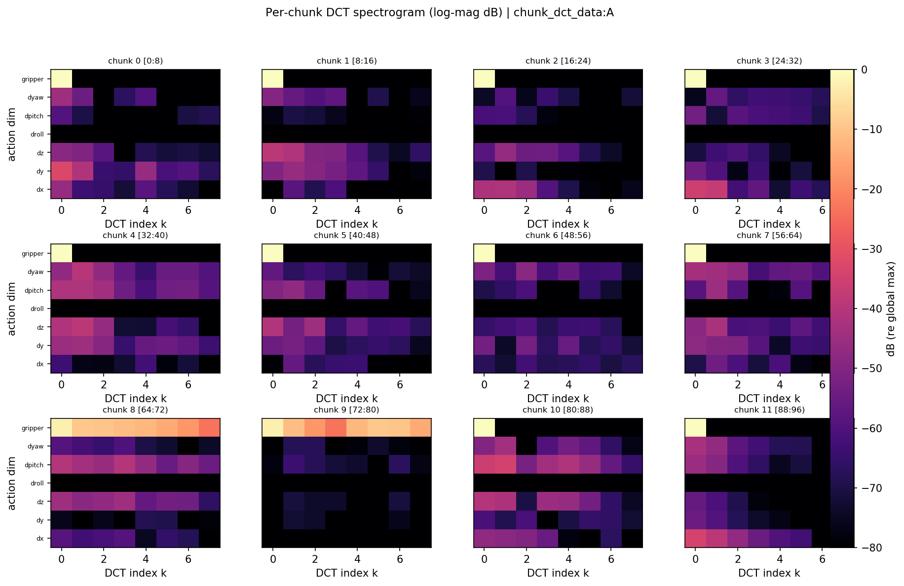
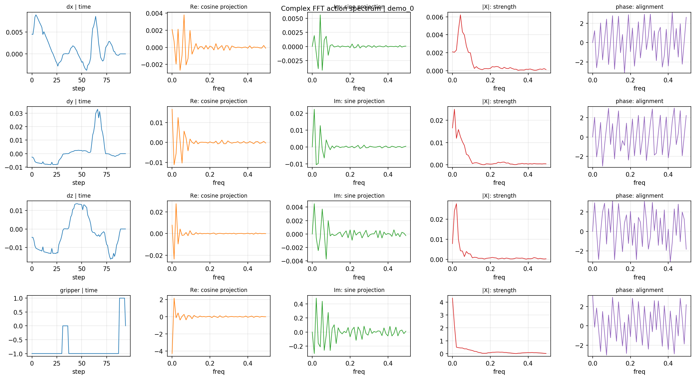
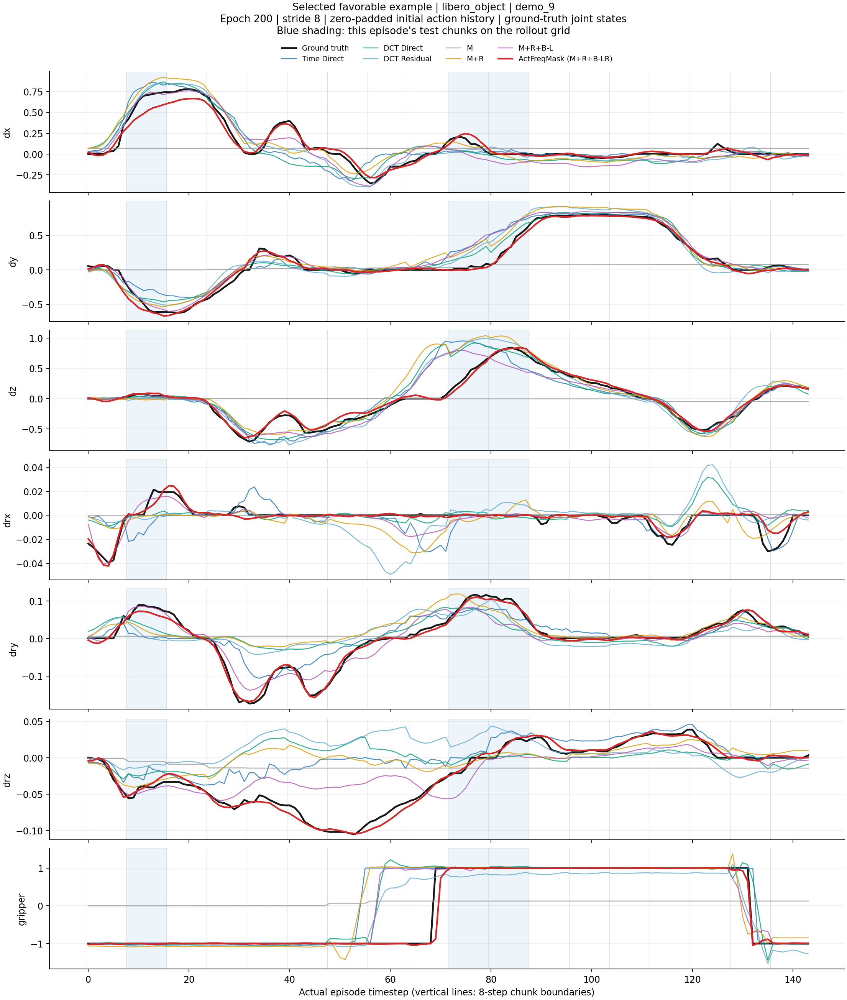

# ActFreqMask: Action as Signal

[](#citation)
[](#todo-list)
[](#demo)

This is the official repository for the paper **"Action as Signal: Masked Inter-Chunk Spectral Transition Modeling for Robot Action Prediction"**.

> **Note:** The paper has been submitted to **ICASSP 2027** and is currently under review. The training and evaluation code, model weights, and full reproduction instructions will be released after the review process is complete.

## News

* **[2026-09]** Our paper was submitted to ICASSP 2027.
* **[2026-09]** Feedback-rollout and action-spectrum visualizations were added to this repository.
* **[2026-09]** A follow-up direction, **FreqMask-VLA**, is being explored for frequency-aware VLA action heads.

## Highlights

* **Inter-chunk spectral continuity:** We analyze adjacent, non-overlapping action chunks in the four LIBERO suites (Spatial, Object, Goal, and Long). Adjacent chunks show strong magnitude-spectrum similarity, especially in low-frequency bands, while retaining non-negligible residual changes.
* **Structured spectral transition:** ActFreqMask predicts the next action spectrum from the preceding spectrum through band-wise masked inheritance and residual correction:
  `C_hat_plus = M * C_minus + Delta C`.
* **Frequency-channel modeling:** DCT-II and signed `asinh` compression produce dynamic-range-controlled spectral maps. A lightweight TC2N encoder models dependencies across frequency bins and action/state channels.
* **Band-wise decoding and fusion:** Independent low-, mid-, and high-frequency decoders predict masks and residuals. Cross-band fusion coordinates the transition before inverse DCT reconstruction.
* **Feedback evaluation:** Every predicted action chunk is fed back as the history for the next prediction, exposing error propagation in long-horizon rollouts rather than evaluating isolated next-chunk predictions.

## Method

Given the preceding action and joint-state histories, ActFreqMask performs the following steps:

1. Apply temporal DCT-II and signed `asinh` compression to obtain action and joint-state spectral representations.
2. Encode frequency-channel dependencies with the TC2N residual 2-D convolutional encoder.
3. Decode low-, mid-, and high-frequency bands into preliminary masks and residuals.
4. Fuse the band-wise predictions and update the preceding action spectrum with masked inheritance and residual correction.
5. Apply inverse DCT-II to reconstruct the next action chunk.

The model is trained with a time-frequency hybrid objective combining time-domain action loss, DCT-coefficient loss, first-order difference loss, and band-wise spectral loss.

## Results

The paper evaluates all methods with iterative feedback on four LIBERO suites. The following values are macro-averaged across the suites and are reported in the submitted manuscript.

| Method | MSE ↓ | MAE ↓ | Gripper F1 ↑ | BSSS ↑ | Spec-W1 ↓ |
| --- | ---: | ---: | ---: | ---: | ---: |
| Time Direct | 0.0557 | 0.0906 | 0.9405 | 0.2897 | 0.0186 |
| DCT Direct | 0.0342 | 0.0734 | 0.9573 | 0.3571 | 0.0146 |
| DCT Residual | 0.0424 | 0.0930 | 0.9476 | 0.3092 | 0.0149 |
| **ActFreqMask** | **0.0204** | **0.0492** | **0.9706** | **0.4705** | **0.0113** |

## Demo

The visualizations below are included as qualitative evidence and signal-analysis examples. They should not be interpreted as a substitute for evaluation over all test episodes.

### Inter-chunk DCT spectra



This example contains 96 action steps and 7 channels. With a chunk size and stride of 8, the sequence is divided into 12 non-overlapping chunks. DCT is applied independently along the temporal axis of each chunk. The stronger low-frequency components illustrate the spectral structure that motivates selective inheritance, while local differences motivate residual correction.

### Action signals and FFT components



This figure shows 95 steps from `demo_0` for the `dx`, `dy`, `dz`, and `gripper` channels. The spectrum uses a Hann window, no mean removal, orthonormal real-input FFT, and a frequency axis in cycles per step. ActFreqMask itself uses DCT coefficients; the complex FFT visualization is provided only to illustrate the frequency structure of robot actions.

### Iterative feedback rollout



For a chunk size of 8, the first history is zero-padded and each predicted chunk becomes the next action history. The rollout continues until the episode ends, making error accumulation and long-horizon drift visible. This figure shows one representative episode; aggregate MSE, MAE, Gripper F1, BSSS, and Spec-W1 should be used for model comparisons.

## TODO List

We are preparing the codebase for public release.

- [ ] Release the PyTorch training and evaluation implementation.
- [ ] Release data preparation scripts for the LIBERO benchmark.
- [ ] Release pretrained checkpoints.
- [ ] Release the complete iterative-feedback evaluation pipeline.
- [ ] Release additional visualizations and analysis scripts.
- [ ] Integrate the spectral transition module into frequency-aware VLA action heads (FreqMask-VLA).

## Citation

If you find this work useful, please cite the submitted paper:

```bibtex
@inproceedings{mattursun2027actfreqmask,
  title     = {Action as Signal: Masked Inter-Chunk Spectral Transition Modeling for Robot Action Prediction},
  author    = {Mattursun, Alimjan and Zhang, Weimin and Chu, Zhongyi},
  booktitle = {Proceedings of the IEEE International Conference on Acoustics, Speech, and Signal Processing (ICASSP)},
  year      = {2027},
  note      = {Under review}
}
```

## Acknowledgement

We thank the LIBERO authors and the open-source robot-learning community for providing the benchmark and the foundations that make this study possible.
